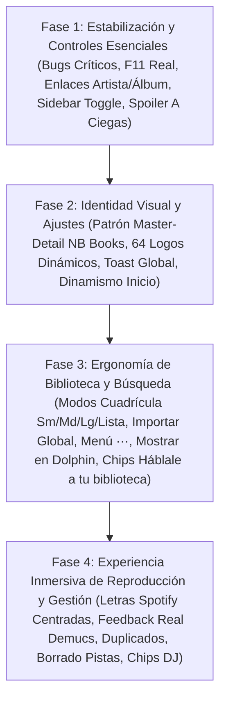

# Informe de Auditoría y Control de Calidad (QA Senior)
**Producto:** NB Sound (Desktop App - WebKitGTK / Tauri 2 / Svelte 5)  
**Versión evaluada:** 0.1.0 (Entorno real de ejecución en Linux Wayland / KDE Plasma 6)  
**Documento:** `observaciones-antes-pruebas-finales.md`  
**Rol:** QA Tester Senior  
**Fecha:** Octubre 2026 (Auditoría Forense Ampliada: Comparativa V1 Legado vs NB Books vs V2)  

---

## 1. Resumen Ejecutivo y Diagnóstico General

Como QA Tester Senior, he realizado una inspección exhaustiva, interactiva y forense sobre la instancia viva de **NB Sound** instalada en tu sistema, contrastándola directamente contra el código fuente del proyecto original (**NB_Sound_legado_v1**, ~111.000 líneas en Python/QML), la aplicación hermana de referencia (**NB_Books**) y los estándares consolidados de la industria musical digital moderna (Spotify, Apple Music, Tidal).

### Lo positivo (La base técnica de Rust)
La reescritura del núcleo en Rust y Tauri 2 logró un rendimiento asombroso en la capa de datos y audio:
- Motor de reproducción nativo con **Kira** de latencia mínima, soporte de ecualizador de 10 bandas y normalización EBU R128.
- Base de datos local transaccional en **SQLite con FTS5** para búsqueda instantánea.
- Pipeline de inferencia neuronal en local mediante **ONNX Runtime** (`htdemucs` para separación de voz/karaoke y modelos Essentia para análisis acústico).
- Motor de **DJ Privado local** con generación de transiciones, compatibilidad armónica y sugerencias de sesión.
- **Minirreproductor flotante** nativo independiente.

### El problema central (La degradación de la Interfaz de Usuario)
El análisis forense del código revela con total claridad lo sucedido:  
**Claude porteó con rigor la lógica de backend, pero realizó un recorte apresurado y destructivo en la UI.**  
Confundió la premisa de *"simplificar la arquitectura"* con *"eliminar interactividad, versatilidad y dinamismo estético"*. En ese proceso se perdieron:
1. **Los modos de visualización ergonómicos** (cuadrícula pequeña, mediana, grande y lista).
2. **El estándar de diseño Master-Detail de `NB_Books` en Ajustes** (dejando una página kilométrica con cajas grises toscas en lugar de navegación por secciones activas con maquetas vivas de temas).
3. **El sistema transversal de notificaciones Toast** de la V1 (dejando la app en un silencio absoluto).
4. **La experiencia inmersiva y ambiental de las letras** (forzando una división rígida al 50% con un bug de desplazamiento crítico y sin modo centrado de karaoke).
5. **Los 64 logotipos dinámicos por tema** (eliminados por decreto en ADR-008, dejando un único logo naranja estático).
6. **El selector de playlists multi-selección** de la V1 (reducido a un menú plano y huérfano en la barra inferior y búsqueda).
7. **La gestión visible del karaoke y los duplicados** (convirtiéndolos en procesos ciegos donde el usuario no sabe si se está trabajando o si su disco se está llenando de copias).
8. **El control del espacio de trabajo** (barra lateral sin colapso manual, ausencia de pantalla completa F11 y spoiler visual en el modo A ciegas).

---

## 2. Hallazgos Críticos y Bugs de Interfaz (Bloqueos y Rupturas Visuales)

---

### [ALERTA] BUG-01: El desplazamiento automático de letras sincronizadas rompe la vista de reproducción completa
- **Ubicación:** `/reproduciendo?letras` (`src/routes/reproduciendo/+page.svelte:62`)
- **Qué se ve / qué pasa:**  
  Al entrar en la vista de reproducción expandida con letras activas, cuando la canción avanza o cuando el usuario hace clic sobre un verso de la letra para adelantar la canción, la función `nodo?.scrollIntoView({ block: 'center', behavior: 'smooth' })` se dispara sobre el elemento activo. Sin embargo, debido a que el contenedor de la página no tiene su altura y desbordamiento aislados (`overflow: hidden` en el wrapper padre y `overflow-y: auto` únicamente en el contenedor de letras), **toda la ventana de la aplicación se desplaza hacia abajo**.  
  Como consecuencia directa, la portada del álbum, el título de la canción, el artista y el botón fundamental `← Volver` **desaparecen expulsados fuera del borde superior de la pantalla**, dejando la mitad izquierda como un vacío desértico marrón/oscuro.
- **Qué piensa / siente el usuario:**  
  *"Se rompió la app. ¿Dónde quedó la portada y el botón para regresar a mi biblioteca? Estoy atrapado en una pantalla que se desplazó sola y no puedo volver atrás salvo que use atajos de teclado o adivine."* Provoca sensación de software inestable y casero.
- **El porqué:**  
  En cualquier reproductor (como Spotify Desktop o Apple Music), la vista de letras se divide en dos columnas fijas: la columna izquierda (portada + título + artista) es **estática (viewport lock)**, y la columna derecha (letras) es la **única** que posee un scroll container independiente. `scrollIntoView()` jamás debe mover el viewport global de la aplicación.
- **Solución recomendada:**  
  Envolver la lista de versos de letras en un contenedor con `height: 100%; max-height: calc(100vh - ...); overflow-y: auto; overscroll-behavior: contain;` y asegurar que el scroll programático se haga respecto a ese contenedor local (`contenedorLetras.scrollTo(...)`) en vez de invocar `scrollIntoView` global en el DOM.

---

### [ALERTA] BUG-02: Desbordamiento vertical insalvable en el modal "Nueva inteligente"
- **Ubicación:** `/playlists` -> Modal "Nueva inteligente" (`DialogoInteligente.svelte`)
- **Qué se ve / qué pasa:**  
  Al pulsar el botón `+ Nueva inteligente` en la sección de Playlists, se despliega un diálogo flotante que contiene 16 campos de formulario y controles apilados verticalmente (título, filtros de género, estados de ánimo, energía, tempo, año, límites, etc.). El contenedor del diálogo carece de `max-height: 90vh` y `overflow-y: auto`.  
  En pantallas estándar de resolución 1080p con escalado de escritorio de 1.25x (como la de este equipo), la parte inferior del diálogo sobrepasa los límites físicos del monitor. **Los botones `Cancelar` y `Crear playlist inteligente` quedan completamente fuera de la pantalla (invisibles e inaccesibles)**. El usuario no puede pulsar "Crear" con el ratón.
- **Qué piensa / siente el usuario:**  
  *"Abrí este formulario y no puedo ni guardar ni cancelar. Hago clic afuera y no se cierra. La app me dejó atrapado en este modal."* Frustración total que obliga a presionar Escape a ciegas o forzar el cierre.
- **El porqué:**  
  Ningún diálogo modal de configuración o creación puede asumir altura de pantalla ilimitada. La regla de oro en UI moderna es que el modal tenga una cabecera fija, un pie fijo con los botones de acción (`Cancelar` / `Aceptar`), y un cuerpo central con scroll independiente (`overflow-y: auto`).
- **Solución recomendada:**  
  Modificar el CSS de `DialogoInteligente.svelte` para añadir cabecera y pie adhesivos (*sticky*) con el área de parámetros desplazable internamente.

---

### [ALERTA] BUG-03: La consulta de búsqueda se queda congelada al navegar a otras pantallas
- **Ubicación:** `BarraSuperior.svelte` (`let consulta = $state(...)`) y navegación general
- **Qué se ve / qué pasa:**  
  El usuario hace clic en el buscador superior o pulsa `Ctrl+K` y escribe un término (por ejemplo `"Rock"` o `"Duki"`). La app filtra en tiempo real y muestra los resultados en `/buscar?q=...`. Acto seguido, el usuario hace clic en el menú lateral para ir a `Playlists`, `Biblioteca` o `Ajustes`.  
  **El texto escrito permanece visible y estático en la caja de búsqueda superior indefinidamente**, a pesar de que el usuario ya está viendo sus Playlists o sus Ajustes generales.
- **Qué piensa / siente el usuario:**  
  *"¿Por qué sigue diciendo 'Rock' arriba? ¿Acaso mis playlists están filtradas por 'Rock'? ¿Tengo que borrar manualmente el texto cada vez que cambio de pantalla?"* Genera desconfianza sobre si la vista actual está filtrada o no.
- **El porqué:**  
  En Svelte 5, el estado `consulta` en `BarraSuperior.svelte` se inicializó solo en el montaje y no reacciona al cambio de ruta (`$page.url.pathname`). En Spotify, YouTube Music o Apple Music, si navegas fuera de la vista de búsqueda, la barra superior se despeja automáticamente, o si vuelves a `/buscar` mediante el botón "Atrás", se restaura.
- **Solución recomendada:**  
  Añadir un `$effect` en `BarraSuperior.svelte` que limpie `consulta = ''` cuando `$page.url.pathname !== '/buscar'`.

---

### [ALERTA] BUG-04: Truncamiento antiestético de textos en el "Radar de ánimos"
- **Ubicación:** `/tu-musica` -> Sección "Radar de ánimos" (`VistaTuMusica.svelte`)
- **Qué se ve / qué pasa:**  
  El gráfico de araña/radar que mapea las dimensiones emocionales de la música del usuario tiene textos SVG en los vértices exteriores. Las etiquetas laterales quedan pegadas y recortadas por el borde del contenedor:
  - En lugar de `Bailable`, se lee `Bailabl`.
  - En lugar de `Nocturna`, se lee `cturna`.
  - En lugar de `Melancólica`, se lee `ncólica`.
- **Qué piensa / siente el usuario:**  
  *"Se ve descuidado, como un gráfico hecho a medias o una librería matemática sin calibrar."* Arruina el impacto visual de una sección que debería ser la joya estética de la app.
- **El porqué:**  
  Los nodos `<text>` del SVG fueron posicionados exactamente en las coordenadas perimetrales del polígono sin margen interno (`padding`) en el `viewBox` del SVG o sin la propiedad CSS `text-anchor: middle / start / end` calculada dinámicamente según el cuadrante.
- **Solución recomendada:**  
  Aumentar el `viewBox` del SVG en 40px por cada lado y verificar que las etiquetas tengan suficiente margen.

---

### [ALERTA] BUG-05: Fallo silencioso sin respuesta visual en "A ciegas"
- **Ubicación:** `/a-ciegas` -> Botón `[RETO] Empezar` (`VistaACiegas.svelte`)
- **Qué se ve / qué pasa:**  
  El usuario entra en "A ciegas", selecciona una modalidad (ej. "Portada"), elige la longitud (5, 10 o 15 retos) y pulsa el botón principal `[RETO] Empezar`. Si la biblioteca no tiene suficientes canciones con carátula o si la función backend rechaza la promesa, **la aplicación no hace absolutamente nada**: el botón no cambia de estado, no hay spinner, no hay mensaje de error, no hay sonido ni vibración.
- **Qué piensa / siente el usuario:**  
  *"¿Hice clic? ¿El botón está roto? ¿La app se congeló?"* El usuario hace clic repetidas veces pensando que el input no se registró.
- **El porqué:**  
  Toda acción asíncrona disparada por un botón primario debe contar con manejo de errores y estados de carga visibles.
- **Solución recomendada:**  
  Implementar manejo de errores con notificación toast visible al usuario en caso de que la inicialización falle.

---

### [ALERTA] BUG-06: Inexistencia total del modo de pantalla completa en la aplicación (F11 / Party Mode)
- **Ubicación:** Toda la aplicación / Tauri Window Manager (`AppShell.svelte` / `src-tauri/`)
- **Qué se ve / qué pasa:**  
  Al pulsar la tecla universal `F11` o al buscar un control en la interfaz para poner la aplicación en modo de pantalla completa (ocultando la barra de título de la ventana y el panel del sistema operativo), **no ocurre absolutamente nada**. No existe ninguna llamada a `getCurrentWindow().setFullscreen(...)` ni en Rust ni en TypeScript.
- **Qué piensa / siente el usuario:**  
  *"Quiero poner la música en mi monitor secundario o en la televisión para una reunión/fiesta, o para cantar con las letras, pero se siguen viendo la barra de título, la barra de tareas de Linux y los bordes de la ventana. ¿Cómo es posible que una app moderna de música no tenga pantalla completa?"*
- **El porqué:**  
  En sistemas de escritorio (Linux, macOS, Windows), el modo pantalla completa (`F11`) es una expectativa de nivel cero en cualquier aplicación multimedia (reproductores de vídeo, Spotify, Apple Music, navegadores). Es indispensable cuando el usuario entra en modo de escucha pasiva o karaoke.
- **Solución recomendada:**  
  1. Registrar un listener global para la tecla `F11` en `svelte:window` que invoque un comando Tauri:
     ```ts
     import { getCurrentWindow } from '@tauri-apps/api/window';
     async function alternarPantallaCompleta() {
       const win = getCurrentWindow();
       await win.setFullscreen(!(await win.isFullscreen()));
     }
     ```
  2. Añadir un icono de pantalla completa en la barra superior o en la barra de reproducción junto al minirreproductor.

---

### [ALERTA] BUG-07: Spoiler visual en el modo "A ciegas" por fallo en el condicional de la Barra de Reproducción
- **Ubicación:** `BarraReproduccion.svelte` (líneas 120-142)
- **Qué se ve / qué pasa:**  
  En `BarraReproduccion.svelte`, el bloque de información de la pista está implementado de la siguiente manera:
  ```svelte
  <div class="datos">
    {#if pista}
      <span class="titulo">{pista.titulo}</span>
      <span class="artista">{pista.artista}</span>
      <span class="album">{pista.album}</span>
    {:else if i.ciego}
      <span class="titulo">{t.aCiegas}</span>
      <span class="artista">{t.adivina}</span>
    {:else} ...
  ```
  Dado que durante una partida de "A ciegas" siempre hay una pista activa sonando, `pista` **siempre es verdadero**. Por lo tanto, el bloque `{:else if i.ciego}` **NUNCA se ejecuta**.  
  Como resultado directo, mientras el usuario está jugando a adivinar la canción con la carátula borrosa o el audio enmascarado, **la barra inferior muestra en texto claro el título, el artista, el álbum y la carátula sin censura**.
- **Qué piensa / siente el usuario:**  
  *"El juego no tiene ningún sentido: me pone a adivinar la canción, pero abajo en la barra de reproducción me está diciendo exactamente qué canción es y de quién es. ¡Me arruinó la partida!"*
- **El porqué:**  
  Error de precedencia lógica de control de flujo. La condición de enmascaramiento `i.ciego` debe evaluarse **antes** de renderizar los metadatos normales de la pista:
  ```svelte
  {#if i.ciego}
    <span class="titulo">{t.aCiegas}</span>
    <span class="artista">{t.adivina}</span>
  {:else if pista}
    <span class="titulo">{pista.titulo}</span> ...
  ```
  Lo mismo aplica para la miniatura de la portada en líneas 120-129: debe mostrar el icono de incógnito si `i.ciego` está activo.
- **Solución recomendada:**  
  Reordenar los bloques condicionales en `BarraReproduccion.svelte` para que `if (i.ciego)` censure tanto la carátula como los textos de datos.

---

## 3. "Te lo esperas y no pasa" (Convenciones y Modelos Mentales Faltantes)

---

### [EXP] EXP-01: Nombre de artista y álbum no clickeables en la barra de reproducción permanente
- **Ubicación:** `BarraReproduccion.svelte` (líneas 131–135)
- **Qué se ve / qué pasa:**  
  En la barra inferior permanente, junto a la miniatura de la carátula, se muestran el título de la canción, el nombre del artista y el nombre del álbum. Cuando el usuario pasa el cursor sobre el nombre del artista o del álbum, el cursor permanece como flecha normal o cambia a texto, pero **no hay subrayado, no hay cambio de color y al hacer clic no ocurre absolutamente nada**. Son simples etiquetas `<span>`.
- **Qué piensa / siente el usuario:**  
  *"Me encanta esta canción que está sonando, quiero ver qué más tiene este artista. Hago clic en su nombre... nada. Hago clic en el álbum... nada. Qué fastidio, ahora tengo que ir al buscador, escribir el nombre del artista a mano para poder encontrarlo."*
- **El porqué:**  
  En Spotify, Apple Music, YouTube Music y prácticamente cualquier reproductor concebido en los últimos 15 años, el nombre del artista y el álbum en la barra de reproducción son **hipervínculos primarios de navegación**. La música es exploratoria por naturaleza; escuchar una pista es la puerta de entrada a explorar la discografía del artista.
- **Solución recomendada:**  
  Convertir ambos elementos en enlaces semánticos accesibles:
  ```svelte
  <a href="/biblioteca/artista?id={pistaActual.artista_id}" class="enlace-artista">
    {pistaActual.artista}
  </a>
  <a href="/biblioteca/album?id={pistaActual.album_id}" class="enlace-album">
    {pistaActual.album}
  </a>
  ```

---

### [EXP] EXP-02: Portada y título en la barra inferior no abren la vista de reproducción completa
- **Ubicación:** `BarraReproduccion.svelte` (Miniatura y Título)
- **Qué se ve / qué pasa:**  
  Hacer clic en la pequeña carátula del álbum en la esquina inferior izquierda o en el título de la pista no tiene efecto alguno. Para abrir la vista expandida (con la carátula grande y las letras), el usuario está obligado a buscar un diminuto icono de flecha diagonal en la esquina extrema derecha de la barra inferior.
- **Qué piensa / siente el usuario:**  
  *"Quiero ver la portada grande o la letra, hago clic en la carátula que está sonando y no se agranda."*
- **El porqué:**  
  En Spotify y Apple Music, hacer clic en la carátula de reproducción actual o en el bloque de información de la canción es el atajo universal para maximizar la vista Now Playing. La miniatura es el blanco de clic (*hitbox*) más reconocible de la barra inferior.
- **Solución recomendada:**  
  Hacer que el bloque izquierdo de información (`.pista-info` o `.miniatura`) sea clickeable y navegue a `/reproduciendo` al pulsarlo.

---

### [EXP] EXP-03: Botón de Importar Música / Carpetas escondido en Biblioteca en lugar de la Barra Superior Global
- **Ubicación:** `BarraSuperior.svelte` vs `src/routes/biblioteca/+page.svelte:229-238`
- **Qué se ve / qué pasa:**  
  Actualmente, la barra superior permanente solo contiene la caja de búsqueda (`Ctrl+K`). Para añadir nuevas canciones o carpetas (`anadirMusica(false)` y `anadirMusica(true)`), el usuario está obligado a dejar lo que esté haciendo, ir al menú lateral, entrar en "Biblioteca" y hacer clic en los botones ubicados en la cabecera interna de esa vista.
- **Qué piensa / siente el usuario:**  
  *"Acabo de descargar un álbum o una carpeta nueva. Estoy en la pantalla de Inicio o revisando una playlist y quiero meterla ya a la app. No veo ningún botón de añadir arriba. Tengo que acordarme de ir a Biblioteca para encontrar el botón de importar."*
- **El porqué:**  
  La ingesta de contenido en un reproductor de archivos locales es una **acción global primaria**. Ubicar los botones `+ Añadir música` y ` Añadir carpeta` en la barra superior (a la derecha o izquierda de la barra de búsqueda mediante un botón de acción principal o menú desplegable `[+ Importar ▼]`) permite al usuario enriquecer su biblioteca desde cualquier pantalla sin perder su contexto de navegación (exactamente como lo diseñó Nathan en `NB_Books`).
- **Solución recomendada:**  
  Replicar la acción de importación en `BarraSuperior.svelte` con un botón desplegable elegante `[+ Importar ▼]`.

---

### [EXP] EXP-04: Modo de Letras no ofrece vista centrada e inmersiva (Estilo Spotify / Apple Music)
- **Ubicación:** `/reproduciendo?letras` (`src/routes/reproduciendo/+page.svelte`)
- **Qué se ve / qué pasa:**  
  Cuando el usuario activa las letras, la pantalla se parte obligatoriamente en dos: a la izquierda queda la carátula gigante fija con los metadatos y a la derecha un bloque estrecho (`<aside class="letras">`) con los versos de la canción. No existe ninguna opción para centrar las letras en toda la pantalla ni para ocultar la carátula.
- **Qué piensa / siente el usuario:**  
  *"Puse el modo de letras porque quiero cantar o leer bien la canción, pero las letras están arrinconadas a la derecha en una columna angosta mientras una carátula fija e inmóvil me roba el 50% de la pantalla. En Spotify las letras salen en el medio, grandes, limpias y protagonistas."*
- **El porqué:**  
  El caso de uso de las letras es la lectura y el karaoke. En pantallas panorámicas (16:9 o ultra-wide), comprimir el texto lírico en el tercio derecho fatiga la vista. Spotify Desktop ofrece la vista de letras como un lienzo centrado, donde el texto corre por el eje medio con un tamaño de fuente generoso y un fondo ambiental desenfocado derivado del color del álbum.
- **Solución recomendada:**  
  Permitir dos modos de visualización de letras en `/reproduciendo`:
  1. *Modo Split* (actual: carátula + letra lateral).
  2. *Modo Inmersivo / Centro* (estilo Spotify): la carátula desaparece, las letras ocupan el ancho medio central con tipografía grande (2.2rem) y auto-scroll fluido sobre un fondo de gradiente sutil.

---

### [EXP] EXP-05: Ausencia total de un botón para Borrar Canción (de la biblioteca y del disco)
- **Ubicación:** `FilaPista.svelte`, `VistaAlbum.svelte`, `src/routes/biblioteca/`
- **Qué se ve / qué pasa:**  
  El usuario examina sus pistas en la biblioteca. Hay botones para editar metadatos `[]`, añadir a playlists `[+]` y abrir el álbum, pero **no existe ninguna acción para eliminar una canción**. Ni un botón de papelera, ni opción en clic derecho, ni tecla `Supr / Delete`.  
  En el backend de Rust existen los métodos de base de datos para borrar pistas con tumbas (`db.eliminar_pista(...)`), pero **no existe ningún comando IPC en Tauri (`borrar_pista`)** expuesto al frontend.
- **Qué piensa / siente el usuario:**  
  *"Tengo una canción duplicada, corrupta o que me descargué por error y ya no la quiero. Busco cómo borrarla en la app y no existe la opción. Me veo obligado a abrir el explorador de archivos Dolphin, buscar la ruta del MP3 y borrarlo a mano fuera de la app."*
- **El porqué:**  
  El control del catálogo propio exige gestión completa del ciclo de vida (CRUD). Los reproductores locales tradicionales (iTunes, MusicBee, Foobar2000, Clementine) siempre han ofrecido dos niveles de eliminación: *"Quitar de la biblioteca"* (desindexar) o *"Eliminar archivo del disco"* (con confirmación de seguridad). Carecer de esto convierte a la app en un lector de solo lectura.
- **Solución recomendada:**  
  1. Implementar el comando Tauri `borrar_pista(id: i64, borrar_archivo: bool)` en `src-tauri/src/comandos.rs`.
  2. Añadir la opción `Eliminar canción...` dentro del menú contextual de la fila de pista, mostrando un diálogo de confirmación que pregunte si desea solo desindexar o enviar el archivo a la papelera del sistema.

---

### [EXP] EXP-06: La barra lateral (Sidebar) no se puede colapsar a modo compacto por voluntad del usuario
- **Ubicación:** `NavLateral.svelte` (`src/lib/ui/NavLateral.svelte:176-212`)
- **Qué se ve / qué pasa:**  
  La barra lateral cuenta con un diseño tipo "riel" (donde solo se muestran los iconos y el logo se reduce a 3rem), pero este estado está condicionado exclusivamente a la anchura de la ventana mediante CSS (`:global(.carcasa:not([data-ancho='amplio']))`). Si el usuario tiene la aplicación maximizada en un monitor de 1080p o 1440p, la barra lateral permanece permanentemente expandida (ocupando más de 200px con un logo enorme de 136px), sin ningún botón para encogerla a iconos.
- **Qué piensa / siente el usuario:**  
  *"Tengo la app maximizada pero quiero darle todo el espacio posible a mis playlists, a las columnas de la biblioteca o a las letras. Quiero colapsar el menú lateral a solo iconos y no puedo. La app decide por mí según el tamaño de mi monitor en vez de dejarme elegir."*
- **El porqué:**  
  La flexibilidad de espacio es un principio básico de las aplicaciones de escritorio modernas (VS Code, Spotify, Discord). Permitir alternar la barra lateral entre modo expandido y riel compacto mediante un botón de alternancia (*toggle button* tipo hamburguesa o flecha `[«] / [»]`) empodera al usuario para adaptar la interfaz a su flujo de trabajo.
- **Solución recomendada:**  
  Añadir un estado persistente en la configuración (`barraLateralColapsada: boolean`) y un botón discreto en la parte superior/inferior de `NavLateral.svelte` que permita colapsar o expandir la barra lateral a voluntad independientemente del ancho de la pantalla.

---

### [EXP] EXP-07: La vista de Artista carece de lista de canciones (Solo muestra álbumes)
- **Ubicación:** `/biblioteca/artista?id=...` (`VistaArtista.svelte`)
- **Qué se ve / qué pasa:**  
  Al entrar al perfil de un artista, se muestra su foto circular en grande, su nombre, el conteo de álbumes y una cuadrícula con sus discos. **No existe una lista de canciones populares ni un listado completo de canciones del artista**.
- **Qué piensa / siente el usuario:**  
  *"Entro a ver a Bad Bunny o a Queen porque quiero escuchar una canción específica de ellos, pero solo me salen 8 carátulas de discos. Tengo que ponerme a abrir disco por disco para adivinar en cuál de ellos estaba la canción que busco."*
- **El porqué:**  
  El perfil de artista en cualquier plataforma musical siempre cuenta con una sección prioritaria: **"Canciones populares"** o **"Todas las canciones"**, seguida más abajo por la discografía. Obligar a navegar por álbumes fragmenta la experiencia de escucha rápida.
- **Solución recomendada:**  
  Incorporar en la vista de artista una sección superior con las canciones más reproducidas del artista, un botón prominente `[ALEATORIO] Reproducir artista en aleatorio`, y debajo la cuadrícula de álbumes.

---

### [EXP] EXP-08: Ausencia de botón de reproducción aleatoria (`[ALEATORIO]`) en cabecera de Playlist
- **Ubicación:** `/playlists/ver?id=...` (`src/routes/playlists/ver/+page.svelte`)
- **Qué se ve / qué pasa:**  
  En la cabecera de una playlist, únicamente se presenta el botón verde `▷ Reproducir` (reproducción secuencial desde la pista 1). No hay botón de `Aleatorio`.
- **Qué piensa / siente el usuario:**  
  *"Tengo una playlist de 200 canciones. No quiero empezar siempre por la canción número 1. Quiero darle al botón aleatorio y que arranque a sonar una pista sorpresa de la lista directamente."*
- **El porqué:**  
  El consumo de playlists es no lineal. Obligar a pulsar `Reproducir` y luego desplazarse a la barra inferior para activar el shuffle es un flujo engorroso y contrario a la costumbre de Spotify/Apple Music.
- **Solución recomendada:**  
  Agregar un botón `[ALEATORIO] Aleatorio` en la cabecera de la playlist junto al botón de reproducción.

---

### [EXP] EXP-09: Búsqueda huérfana sin menú contextual de acciones
- **Ubicación:** `/buscar` (`src/routes/buscar/+page.svelte`)
- **Qué se ve / qué pasa:**  
  En los resultados de búsqueda global, al encontrar una pista musical, el usuario solo puede hacer clic para reproducirla de inmediato. No existe ningún botón ni menú para añadir a la cola, añadir a una playlist existente o ver el álbum/artista.
- **Qué piensa / siente el usuario:**  
  *"Estoy armando una playlist, busco una canción, la encuentro... y si le doy clic me corta la música que estaba escuchando y me la reproduce de golpe en vez de dejarme meterla a mi playlist."*
- **El porqué:**  
  La búsqueda es la herramienta primaria para curar música y gestionar la cola. Un resultado de búsqueda debe tener exactamente las mismas capacidades de acción que una fila de la biblioteca.
- **Solución recomendada:**  
  Integrar el componente de menú de acciones (`MenuAcciones` o `···`) a cada resultado de pista en la vista de búsqueda.

---

### [EXP] EXP-10: Botón redundante "Abrir álbum" dentro de la propia página del álbum
- **Ubicación:** `/biblioteca/album?id=...` (`FilaPista.svelte`)
- **Qué se ve / qué pasa:**  
  Cuando el usuario ya está dentro de la vista detallada de un álbum, cada una de las canciones de la lista sigue mostrando un botón con el icono de un disco cuyo tooltip dice `Abrir álbum`. Al hacer clic, simplemente recarga la misma página donde el usuario ya se encuentra.
- **Qué piensa / siente el usuario:**  
  *"¿Por qué esta fila me ofrece un botón para ir al álbum si ya estoy viendo el álbum? Me estorba y me confunde."*
- **El porqué:**  
  El componente `FilaPista.svelte` se utiliza de forma genérica en todas partes sin pasarle una propiedad contextual (ej. `contexto="album"`).
- **Solución recomendada:**  
  Añadir la prop `ocultarEnlaceAlbum={true}` en la llamada a `FilaPista` dentro de `VistaAlbum.svelte`.

---

### [EXP] EXP-11: Doble clic en la fila para reproducir
- **Ubicación:** Todas las tablas de pistas (`Biblioteca`, `Playlists`, `Álbum`).
- **Qué se ve / qué pasa:**  
  Para reproducir una pista, el usuario debe mover cuidadosamente el puntero del ratón para acertar sobre el diminuto botón verde `▷ Reproducir` que se encuentra apiñado en la fila. Hacer doble clic en el cuerpo de la fila (sobre el título, la duración o el espacio vacío) no hace nada.
- **Qué piensa / siente el usuario:**  
  *"Tengo que apuntar con puntería láser al botoncito de play en cada fila. En cualquier app de escritorio (Spotify, iTunes, VLC), le das doble clic a la fila y la canción empieza a sonar."*
- **El porqué:**  
  En aplicaciones de escritorio, el doble clic en una fila de datos es la convención canónica de ejecución.
- **Solución recomendada:**  
  Añadir el evento `ondblclick={() => reproducirPista(pista)}` en el contenedor de `FilaPista.svelte`.

---

### [EXP] EXP-12: Falta de indicador visual de "pista sonando actualmente" en las listas
- **Ubicación:** Listas virtuales y tablas de pistas
- **Qué se ve / qué pasa:**  
  Cuando una canción está reproduciéndose y el usuario navega por su lista de pistas o playlist, la fila de la pista en reproducción no muestra ningún icono de ecualizador animado ni el número de pista se convierte en una onda verde.
- **Qué piensa / siente el usuario:**  
  *"Estoy escuchando esta playlist, bajo por la lista y no sé a simple vista cuál es la que está sonando ahorita mismo."*
- **El porqué:**  
  El indicador de reproducción en curso (tres barritas animadas o título en color acento) es el ancla visual básica para orientar al oyente.
- **Solución recomendada:**  
  Sustituir el número de índice por un micro-icono animado de ecualizador y colorear el título cuando la pista coincida con la actual.

---

### [EXP] EXP-13: Tarjetas de estadísticas inertes en Inicio y Tu Música
- **Ubicación:** `/` (Tarjetas `2243 Pistas`, `435 Artistas`, `1423 Álbumes`) y `/tu-musica` (Métricas globales)
- **Qué se ve / qué pasa:**  
  En la pantalla de Inicio, debajo del saludo, aparecen tres tarjetas grandes con tipografía destacada que indican cuántas pistas, artistas y álbumes componen la biblioteca. Al situar el puntero del ratón encima, tienen sombra y aspecto de botón; sin embargo, al hacer clic sobre ellas, no hacen nada.
- **Qué piensa / siente el usuario:**  
  *"Veo '435 Artistas', le doy clic esperando que me lleve directo a la pestaña de Artistas de mi biblioteca... y no pasa nada. Parece un botón, tiene forma de botón, pero es un adorno."*
- **El porqué:**  
  Si un elemento tiene forma de tarjeta elevada con contorno y contador numérico en un panel de control, el modelo mental del usuario asume que es un acceso directo de desglose (*drill-down*).
- **Solución recomendada:**  
  Envolver cada tarjeta en su respectiva ruta de navegación hacia la biblioteca.

---

## 4. Sobrecarga Visual y Pulido Estético ("Cosas que se ven feas o toscas")

---

### [DIS] DIS-01: La vista de Ajustes (`/ajustes`) es visualmente tosca, monótona y desestructurada
- **Ubicación:** `/ajustes` (`src/routes/ajustes/+page.svelte`, `SeccionesEscucha.svelte`)
- **Qué se ve / qué pasa:**  
  La página de Ajustes se presenta como una sucesión interminable de enormes cajas rectangulares rodeadas por un borde gris tosco de 1px (`border: 1px solid var(--m3c-outline-variant)`). La columna de navegación de la izquierda es una lista plana de enlaces `<a href="#...">` sin iconos ni estilos activos atractivos. Los controles de ecualizador se ven planos y los 63 temas están volcados en una cuadrícula masiva e inabarcable sin segmentar.
- **Qué piensa / siente el usuario:**  
  *"Esta vista se siente como un prototipo técnico o un archivo de configuración sin diseñar. No dan ganas de explorar las opciones de la app porque todo se ve gris, cuadrado y amontonado."*
- **El porqué:**  
  En aplicaciones modernas (como GNOME Web/Music, macOS Preferences o Spotify Settings), los ajustes no se arrojan en una sola página kilométrica con bordes pesados. Se estructuran mediante:
  1. **Pestañas o navegación segmentada lateral** (General, Reproducción y Audio, Apariencia, Dispositivos, Agregados/IA).
  2. **Tarjetas de agrupación limpia con esquinas redondeadas** y switches modernos con animación fluida.
  3. **Categorización de temas** (Oscuros, Claros, Neón/OLED, Monocromáticos).
- **Solución recomendada:**  
  Rediseñar la vista de Ajustes implementando navegación por pestañas desacopladas (evitando el scroll infinito), modernizando los deslizadores y agrupando la galería de temas en categorías con filtros rápidos (siguiendo el modelo maestro de `NB_Books`).

---

### [DIS] DIS-02: Los logotipos de marca no cambian con el tema (Assets desaprovechados en `NB_Sound_Mobile`)
- **Ubicación:** `NavLateral.svelte:50` (``)
- **Qué se ve / qué pasa:**  
  La barra lateral siempre muestra el mismo logotipo estático naranja/rojizo (`/logo.png`), sin importar qué tema elija el usuario en Ajustes. Sin embargo, en el proyecto hermano de la aplicación (`../NB_Sound_Mobile/assets/app_icons/`), existen **más de 60 variantes exclusivas del logotipo diseñadas meticulosamente para cada tema individual** (`logo_acero_azul.png`, `logo_esmeralda.png`, `logo_lava.png`, `logo_terminal_verde.png`, `logo_zafiro_medianoche.png`, etc.). Estos archivos nunca fueron transferidos a la carpeta `static/` del proyecto de escritorio ni vinculados a la reactividad de `aparienciaActual.actual.tema`.
- **Qué piensa / siente el usuario:**  
  *"Pongo el tema Terminal Verde o Glacial y el logo sigue con el color naranja por defecto que desentona totalmente con la estética que elegí. ¿Por qué no cambia el logo con el tema si los iconos existen?"*
- **El porqué:**  
  El cambio de logotipo sincronizado con la paleta de color es un detalle de identidad visual de altísimo nivel (*signature polish*). Dejar el logo estático rompe la inmersión del tema dinámico.
- **Solución recomendada:**  
  1. Copiar los archivos de iconos desde `NB_Sound_Mobile/assets/app_icons/` hacia `static/logos_temas/`.
  2. En `NavLateral.svelte`, derivar la ruta de la imagen según el tema activo:
     ```svelte
     {@const rutaLogo = `/logos_temas/logo_${aparienciaActual.actual.tema}.png`}
      (e.currentTarget.src = '/logo.png')} />
     ```

---

### [DIS] DIS-03: "Síndrome de tabla de Excel": Hasta 10 botones explícitos por cada fila
- **Ubicación:** `FilaPista.svelte` en Biblioteca y Playlists
- **Qué se ve / qué pasa:**  
  Cada fila individual de una pista musical renderiza de forma simultánea una hilera horizontal de botones:
  `[] [+] [▷] [Cola] [] [Disco] [Artista] [^] [v] [X]`. Al tener una lista de 50 canciones, la pantalla se convierte en una cuadrícula densa de 500 botones visuales compitiendo entre sí.
- **Qué piensa / siente el usuario:**  
  *"Esto parece un panel de administración de base de datos o una hoja de Excel sobrecargada, no una aplicación moderna de música para relajarme."*
- **El porqué:**  
  Satura la carga cognitiva del usuario violando el principio de revelación progresiva (*progressive disclosure*).
- **Solución recomendada:**  
  Colapsar las acciones secundarias dentro de un menú contextual `···` que aparezca al pasar el cursor (`:hover`), dejando la fila limpia con solo título, artista, duración y corazón.

---

### [DIS] DIS-04: Doble fila de 14 chips de filtrado y ordenamiento en Biblioteca
- **Ubicación:** `/biblioteca` (Zona superior de la lista)
- **Qué se ve / qué pasa:**  
  En la parte superior de la biblioteca se muestran dos filas continuas de botones tipo pastilla (chips) para ordenar: `Recientes`, `Título`, `Artista`, `Álbum`, `Duración`, `Año`, `Reproducciones`, `Favoritos`, `A-Z`, `Z-A`, etc. Ocupan casi un tercio de la altura disponible antes de mostrar la primera canción.
- **Qué piensa / siente el usuario:**  
  *"Hay demasiado ruido antes de llegar a mis canciones. Se come la mitad de la pantalla y parece una lista de etiquetas desordenada."*
- **El porqué:**  
  El patrón estándar de la industria es un selector dropdown compacto: `Ordenar por: [Título ▼] [↑↓]`.
- **Solución recomendada:**  
  Reemplazar el enjambre de 14 chips por un selector desplegable estilizado que ocupe una sola línea compacta.

---

### [DIS] DIS-05: Tooltips nativos del navegador (`title="..."`) que se solapan y crean artefactos
- **Ubicación:** Menú lateral y botones de navegación
- **Qué se ve / qué pasa:**  
  Muchos enlaces y botones tienen el atributo HTML nativo `title="..."`. Cuando el usuario pasa el ratón por el menú lateral sobre "Playlists" o "Tu música", el tooltip nativo de WebKitGTK aparece encima del propio texto o del botón adyacente, creando textos superpuestos ilegibles (por ejemplo, leyéndose `"Playlistsica"`).
- **Qué piensa / siente el usuario:**  
  *"Se ve sucio, cada vez que muevo el mouse me salen cartelitos feos que tapan las palabras."*
- **El porqué:**  
  Los tooltips nativos del sistema operativo carecen de retardo calibrado y no respetan el tema de la aplicación.
- **Solución recomendada:**  
  Eliminar los atributos `title` redundantes en textos que ya son auto-explicativos.

---

### [DIS] DIS-06: Mapa de calor de 24 horas huérfano de horas de referencia
- **Ubicación:** `/tu-musica` -> Sección "Mapa de actividad horaria"
- **Qué se ve / qué pasa:**  
  Se muestra una cuadrícula con 7 filas (días de la semana) y 24 columnas (las horas del día) con cuadritos de colores. No hay ninguna indicación numérica de las horas arriba ni abajo (00:00, 06:00, 12:00, 18:00).
- **Qué piensa / siente el usuario:**  
  *"Veo un cuadro morado oscuro en la columna 17... ¿qué hora es esa? ¿Las 3 de la tarde? ¿Las 5? ¿Tengo que contar los cuadritos con el dedo uno por uno desde el principio para saber a qué hora escucho música?"*
- **El porqué:**  
  Un gráfico cuantitativo sin ejes rotulados pierde su valor informativo y se convierte en una simple textura abstracta.
- **Solución recomendada:**  
  Añadir marcas horarias (`00h`, `06h`, `12h`, `18h`, `23h`) y tooltips informativos con el día, hora exacta y reproducciones.

---

### [DIS] DIS-07: Carruseles horizontales de Inicio (`.fila`) sin controles de avance (`‹` / `›`) ni snap
- **Ubicación:** `src/routes/+page.svelte:578-586`
- **Qué se ve / qué pasa:**  
  En Inicio, las secciones "Playlists destacadas", "Álbumes que te gustan", "Artistas" y "Últimos añadidos" se muestran como filas con `overflow-x: auto` sin ninguna flecha o botón flotante de desplazamiento lateral.
- **Qué piensa / siente el usuario:**  
  *"En Linux con un ratón convencional de escritorio (sin trackpad ni rueda horizontal), para desplazarme por las canciones tengo que buscar la barra de desplazamiento horizontal delgadita con el cursor o arrastrar forzado. En Spotify o Netflix hay flechas claras en los extremos para pasar a las siguientes tarjetas."*
- **El porqué:**  
  La ergonomía de escritorio requiere soporte para ratón tradicional mediante botones de navegación horizontal y desplazamiento con ajuste automático (*scroll-snap-type: x mandatory*).
- **Solución recomendada:**  
  Añadir botones flotantes de navegación lateral `[‹]` y `[›]` en cada carrusel de Inicio y habilitar `scroll-snap`.

---

## 5. "Tocas y no sabes si funciona" (Falta de Feedback y Estados de Carga)

---

### [FDB] FDB-01: Preparación del Karaoke completamente opaca e invisible
- **Ubicación:** `BarraReproduccion.svelte:243-260` (Botón de micrófono)
- **Qué se ve / qué pasa:**  
  Al pulsar el botón del micrófono para activar o preparar el karaoke de una canción, si el instrumental aún no está separado, el código llama a `karaokePreparar([pistaId])` e intenta renderizar un sutil borde en gradiente cónico en CSS (`style:--progreso`). Sin embargo, en la práctica:
  - En un botón circular diminuto de 32x32 píxeles, ese gradiente es prácticamente imperceptible.
  - No hay ningún texto en pantalla que diga *"Preparando pista instrumental..."*.
  - No hay porcentaje numérico visible salvo que se pose el ratón encima y se espere el tooltip nativo.
  - Si la separación tarda 30 segundos o 1 minuto (por cálculo en CPU/GPU de ONNX), el usuario no sabe si la app se colgó o si sigue trabajando.
- **Qué piensa / siente el usuario:**  
  *"Le di al micrófono del karaoke... ¿empezó a preparar algo? ¿está descargando el modelo? ¿se trabó la app? Nunca me doy cuenta de si de verdad se está preparando el karaoke de una canción o si no hizo nada."*
- **El porqué:**  
  La separación de fuentes de audio mediante redes neuronales es uno de los procesos más pesados de la aplicación. Ocultar este progreso detrás de un micro-anillo CSS sin feedback explícito en la interfaz genera incertidumbre absoluta.
- **Solución recomendada:**  
  1. Mostrar una notificación Toast o barra de estado en la parte inferior mientras se prepara:
     `[KARAOKE] Preparando karaoke para "[Título]" · 45%` con una barra de progreso real.
  2. Si el modelo no está descargado o falla, informar con claridad el motivo en lugar de permanecer en silencio.

---

### [FDB] FDB-02: Gestión de canciones duplicadas en una "caja negra" (Sin visibilidad ni limpieza de disco)
- **Ubicación:** `src-tauri/src/catalogo/canalizacion.rs` vs Interfaz de usuario
- **Qué se ve / qué pasa:**  
  En el motor de Rust existen algoritmos avanzados de detección de duplicados por tres ejes (huella de archivo, identidad de metadatos y similitud observable). Cuando se detecta un duplicado, se marca internamente o se envía a la tabla de `por_revisar`.  
  Sin embargo, **en la interfaz de usuario no hay ninguna sección, contador ni botón que informe sobre los duplicados**:
  - El usuario no sabe si hay archivos duplicados ocupando gigabytes en su disco.
  - No existe un botón de *"Limpiar duplicados del disco automáticamente"* para mantener limpio el almacenamiento.
  - No hay ningún reporte que diga *"Se omitieron 12 pistas por ser duplicadas exactas"*.
- **Qué piensa / siente el usuario:**  
  *"He importado varias carpetas y no sé si tengo canciones repetidas gastando espacio en mi disco. No veo que los duplicados se estén borrando solos para mantener limpio todo ni veo dónde revisarlos."*
- **El porqué:**  
  Un gestor de música moderno para audiófilos y coleccionistas debe ofrecer transparencia y tranquilidad. La deduplicación no puede ser un proceso invisible que deja archivos huérfanos en el disco.
- **Solución recomendada:**  
  1. Crear un apartado en Ajustes o en Biblioteca: *"Mantenimiento y Duplicados"*.
  2. Mostrar una tarjeta de diagnóstico: *"X canciones duplicadas encontradas (espacio recuperable: Y MB)"*.
  3. Ofrecer dos opciones: `Purgar duplicados del disco automáticamente` y `Revisar antes de eliminar`.

---

### [FDB] FDB-03: Botones de exportar, importar o limpiar caché en Ajustes sin confirmación Toast
- **Ubicación:** `/ajustes` -> "Biblioteca" y "Mantenimiento"
- **Qué se ve / qué pasa:**  
  Al pulsar botones como `Analizar biblioteca ahora`, `Optimizar base de datos` o `Exportar configuración`, el sistema realiza la tarea internamente pero no aparece ninguna notificación flotante tipo Toast.
- **Qué piensa / siente el usuario:**  
  *"Le di clic... ¿hizo algo? ¿falló? ¿terminó ya o sigue trabajando de fondo?"*
- **El porqué:**  
  Cualquier operación de mantenimiento del sistema requiere confirmación explícita de éxito (*affirmative feedback*) para cerrar el ciclo de acción del usuario.
- **Solución recomendada:**  
  Conectar un sistema global de notificaciones Toast que confirme visualmente la finalización de tareas de mantenimiento.

---

### [FDB] FDB-04: Reordenamiento de pistas en Playlist (`^`, `v`) sin animación ni estado deshabilitado
- **Ubicación:** `/playlists/ver?id=...` (Botones de flecha arriba y flecha abajo)
- **Qué se ve / qué pasa:**  
  En una playlist, el usuario pulsa la flecha arriba `[^]` en la primera canción de la lista, o la flecha abajo `[v]` en la última. El botón se puede presionar y emite el clic, pero la lista no se mueve.
- **Qué piensa / siente el usuario:**  
  *"Le doy a la flecha y a veces no hace nada, parece trabado."*
- **El porqué:**  
  Los botones que representan acciones inválidas deben mostrarse deshabilitados (`disabled={indice === 0}`).
- **Solución recomendada:**  
  Aplicar condición de deshabilitado en primer y último elemento.

---

### [FDB] FDB-05: Botón "Generar sesión" en DJ Privado tarda sin mostrar progreso
- **Ubicación:** `/dj` (`src/routes/dj/+page.svelte`)
- **Qué se ve / qué pasa:**  
  Al seleccionar un preset o escribir una instrucción y pulsar `Generar sesión`, la operación tarda entre 1.5 y 3 segundos sin mostrar ningún estado visual de carga.
- **Qué piensa / siente el usuario:**  
  *"¿Se quedó pensando o no leyó mi clic?"*
- **El porqué:**  
  Cualquier tiempo de espera superior a 300ms requiere un estado visual de carga (esqueleto animado o barra de progreso indeterminada).
- **Solución recomendada:**  
  Mostrar un esqueleto (*skeleton loader*) mientras se calcula la sesión del DJ.

---

## 6. Matriz Priorizada de Recomendaciones Técnicas

| ID | Severidad | Componente / Archivo | Problema Detectado | Solución Técnica Sugerida |
|---|---|---|---|---|
| **BUG-01** | **Crítica (Bloqueante)** | `reproduciendo/+page.svelte` | `scrollIntoView` en letras descoloca el viewport completo y oculta los controles. | Aislar el contenedor de letras con `overflow-y: auto; max-height: 100%` y usar `container.scrollTo()`. |
| **BUG-02** | **Crítica (Bloqueante)** | `DialogoInteligente.svelte` | Modal vertical sobrepasa la pantalla y esconde los botones de Guardar/Cancelar. | Asignar `max-height: 85vh; display: flex; flex-direction: column` con scroll en el cuerpo y botones fijos abajo. |
| **BUG-07** | **Crítica (Lógica Juego)** | `BarraReproduccion.svelte` | En modo A ciegas, la barra inferior revela el título, artista y carátula. | Reordenar condicional en `BarraReproduccion` para que `i.ciego` tenga prioridad sobre `pista`. |
| **BUG-06** | **Alta (Esperada)** | Tauri / `AppShell.svelte` | Inexistencia del modo Pantalla Completa (F11 / Party mode). | Implementar atajo F11 y botón dedicado usando `getCurrentWindow().setFullscreen()`. |
| **COMP-01** | **Alta (Ergonomía)** | `biblioteca/` y `playlists/` | Eliminación de modos de vista (Cuadrícula Pequeña, Mediana, Grande y Lista). | Restaurar selector persistente de modos de cuadrícula y lista en Svelte 5. |
| **DIS-01** | **Alta (Estética)** | `ajustes/+page.svelte` | Vista de ajustes tosca, cajas pesadas y scroll masivo de 63 temas sin agrupar. | Rediseñar con patrón Master-Detail de `NB_Books`, tarjetas limpias y maquetas vivas de temas. |
| **COMP-03** | **Alta (Feedback)** | App global (`Toast.svelte`) | Desaparición de los avisos Toast presentes en la V1. | Crear gestor reactivo global de Toasts (`toast.exito()`, `toast.error()`, `toast.info()`). |
| **EXP-03** | **Alta (Esperada)** | `BarraSuperior.svelte` | Botones de añadir música y carpeta enterrados en Biblioteca. | Trasladar/replicar botón global de importación `[+ Importar ▼]` en la barra superior. |
| **EXP-04** | **Alta (Esperada)** | `reproduciendo/+page.svelte` | Modo de letras no ofrece vista centrada e inmersiva (estilo Spotify). | Crear alternador para vista de letras centrada a ancho completo sin carátula estática lateral. |
| **EXP-05** | **Alta (Esperada)** | Backend Rust / `FilaPista.svelte` | Ausencia total de opción para borrar canciones de la biblioteca o del disco. | Exponer comando IPC `borrar_pista` y añadir opción con confirmación en el menú contextual. |
| **DIS-02** | **Alta (Estética)** | `NavLateral.svelte` / `static/` | El logo siempre es el mismo `/logo.png`, desaprovechando los 64 logos de temas. | Copiar iconos desde `NB_Sound_Mobile/assets/app_icons/` y vincular imagen al tema activo. |
| **FDB-01** | **Alta (Feedback)** | `BarraReproduccion.svelte` | Preparación de karaoke invisible sin feedback real de progreso. | Mostrar notificación Toast o barra de estado visible con porcentaje y estado de la separación ONNX. |
| **FDB-02** | **Alta (Feedback)** | `catalogo/canalizacion.rs` / UI | Gestión de duplicados invisible; no hay limpieza automática de disco. | Crear módulo de duplicados en Ajustes con opción de purga automática de archivos redundantes. |
| **EXP-06** | **Alta (UX)** | `NavLateral.svelte` | La barra lateral solo se achica por tamaño de ventana, sin control manual. | Añadir botón de alternancia (*toggle*) para colapsar/expandir la barra lateral a modo riel a voluntad. |
| **COMP-09** | **Alta (UX)** | `MenuAnadir.svelte` | Selector de playlist simplificado a lista plana de 1 clic sin multi-selección ni presencia global. | Restaurar selector con checkboxes de pertenencia previa, botón guardar y apertura desde reproductor. |
| **COMP-13** | **Alta (Ergonomía)** | `FilaPista` / `PorRevisar` | Falta opción "Mostrar en explorador de archivos" (Reveal in Dolphin/File Manager). | Exponer comando IPC `abrir_en_explorador(ruta)` para revelar archivos en el explorador del SO. |
| **COMP-14** | **Media (UX)** | `src/lib/ui/dj/` | DJ Privado carece de chips interactivos de palabras ontológicas. | Incorporar categorías clicables de palabras (Voces, Géneros, Ánimos, Energía, Contextos). |
| **EXP-01** | **Media (Esperada)** | `BarraReproduccion.svelte` | Nombre de artista y álbum no son enlaces clickeables. | Convertir los `<span>` en `<a href="/biblioteca/artista?id=...">` con estilos de enlace. |
| **EXP-02** | **Media (Esperada)** | `BarraReproduccion.svelte` | Carátula y título en la barra no abren la vista completa. | Envolver la carátula y el bloque de texto en un link o botón hacia `/reproduciendo`. |
| **DIS-03** | **Media (UX)** | `FilaPista.svelte` | Fila saturada con hasta 10 botones explícitos (aspecto de tabla técnica). | Colapsar acciones secundarias dentro de un menú desplegable contextual `···`. |
| **BUG-03** | **Media** | `BarraSuperior.svelte` | Consulta de búsqueda queda congelada al salir de `/buscar`. | Limpiar `consulta = ''` mediante un `$effect` cuando la ruta cambie fuera de `/buscar`. |
| **EXP-07** | **Media (Esperada)** | `VistaArtista.svelte` | La vista de Artista solo tiene álbumes, sin lista de canciones populares. | Añadir bloque de canciones destacadas del artista antes de la cuadrícula de álbumes. |
| **EXP-08** | **Media (Esperada)** | `playlists/ver/+page.svelte` | No hay botón de reproducción aleatoria en la cabecera de la playlist. | Añadir botón `[ALEATORIO] Aleatorio` junto al botón `▷ Reproducir`. |
| **DIS-07** | **Media (Ergonomía)** | `src/routes/+page.svelte` | Carruseles de Inicio sin botones `‹` / `›` ni snap-scrolling para ratón estándar. | Añadir controles flotantes de navegación lateral y CSS scroll-snap. |
| **BUG-04** | **Baja** | `VistaTuMusica.svelte` | Etiquetas del radar de ánimos truncadas (`Bailabl`, `cturna`). | Aumentar el `viewBox` del SVG y calibrar márgenes y `text-anchor`. |
| **EXP-11** | **Baja** | `FilaPista.svelte` | Doble clic en la fila no reproduce la pista. | Implementar `ondblclick` en el contenedor de la fila. |
| **DIS-04** | **Baja** | `biblioteca/+page.svelte` | 14 chips de ordenamiento apilados en dos filas roban demasiado espacio. | Reemplazar por un selector dropdown compacto: `Ordenar por: [Nombre ▼] [↑↓]`. |
| **DIS-06** | **Baja** | `VistaTuMusica.svelte` | Heatmap de 24 horas sin rotulación de horas. | Añadir indicadores de hora (00h, 06h, 12h, 18h) y tooltips informativos. |
| **FDB-03** | **Baja** | `ajustes/+page.svelte` | Acciones de mantenimiento sin confirmación visual. | Lanzar notificaciones Toast al completar optimizaciones o exportaciones. |

---

## 7. Conclusión y Veredicto del QA Senior

Esta auditoría forense demuestra que **NB Sound tiene un motor de ingeniería de clase mundial (Rust, Kira, ONNX, SQLite)**, pero que el port de la interfaz quedó truncado a medio camino. La aplicación actual da la impresión errónea de ser un software tosco, cuando en realidad el código fuente del proyecto legado ya demostraba una sofisticación visual altísima (fondos ambientales dinámicos, modos de vista, feedback instantáneo y 64 identidades de logo).

Restaurando estos componentes maestros e integrando la arquitectura de diseño pulida de **NB Books**, la V2 de NB Sound superará con creces tanto a la versión original de Python como a cualquier reproductor de escritorio actual en Linux.

---

## 8. Informe Forense del Port: Comparativa Detallada V1 (QML/Python) vs NB Books vs V2 (Tauri/Rust)

Tras contrastar directamente el código fuente del proyecto legado (**NB_Sound_legado_v1**, ~111.000 líneas en Python/QML), la aplicación de referencia del ecosistema (**NB_Books**) y las decisiones registradas en los ADRs contra la implementación viva de la V2 en Tauri/Rust, se documenta la pérdida específica de funcionalidades:

---

### [COMP] COMP-01: Pérdida total de los Modos de Visualización (Cuadrículas y Modo Lista)
* **Cómo funcionaba en la V1 (`VistaPlaylists.qml:280-340`, `VistaBiblioteca.qml:1024-1035`):**  
  Tanto en Biblioteca (Álbumes y Artistas) como en Playlists, el usuario tenía un selector de vista persistente con 4 modos distintos guardados en configuración (`playlists_modo_vista` / `biblioteca_modo_vista`):
  1. `grid-sm` (Cuadrícula pequeña, base 168px): máxima densidad de carátulas para coleccionistas con monitores grandes.
  2. `grid-md` (Cuadrícula mediana, base 220px): equilibrio entre arte y títulos.
  3. `grid-lg` (Cuadrícula grande, base 282px): disfrute visual de portadas en alta definición.
  4. `lista` (Modo lista, filas de 86px): formato horizontal compacto para explorar rápidamente muchas listas o álbumes sin scroll interminable.  
  El tamaño de las tarjetas ajustaba dinámicamente la tipografía, márgenes y si se mostraban 1, 2 o 3 líneas de metadatos (`modoTarjeta === 0 ? 0 : 2`).
* **Cómo está concebido en `NB_Books` (`LibraryView.svelte:102-116`):**  
  Nathan definió el estándar canónico en `NB_Books`:
  ```svelte
  const MODOS = [
    ['cuadricula', 'cuadricula', 'cuadricula'], // Para elegir mirando: portada grande y ficha
    ['mosaico', 'mosaico', 'mosaico'],       // Para reconocer de un vistazo
    ['lista', 'lista', 'lista']               // Para comparar datos en columnas alineadas
  ] as const;
  ```
* **Qué hizo Claude en la V2 de NB Sound:**  
  Eliminó por completo los selectores de modo y tamaño. Forzó una única cuadrícula estática (`repeat(auto-fill, minmax(11rem, 1fr))`) para Álbumes y Playlists, y una tabla fija e inmutable para Pistas. Se perdió toda la versatilidad ergonómica de la interfaz.

---

### [COMP] COMP-02: La degradación de Ajustes frente al estándar de `NB_Books`
* **Cómo está diseñado en `NB_Books` (`SettingsView.svelte:1-22, 2550-2950`):**  
  En `NB_Books`, la vista de ajustes cuenta con 118 KB de código impecablemente estructurado:
  1. **Navegación Master-Detail:** Una barra lateral izquierda con pestañas (`.nb-ajustes-nav`) con iconos y títulos limpios. **A la derecha se renderiza ÚNICAMENTE la sección activa**. No hay scroll infinito ni fatiga visual.
  2. **Tarjetas modulares elevadas (`<Seccion>`):** Cada bloque de configuración es una tarjeta con fondo elevado, esquinas redondeadas suaves, descripción de ayuda clara en gris (`.nb-ayuda`), subtítulos jerárquicos y botones de acción agrupados (`.nb-acciones-diagnostico`).
  3. **Campos de formulario de alta gama:** Inputs con anillos de foco accesibles (`.nb-entrada:focus-visible`), interruptores con micro-animaciones fluidas y diagnósticos en bloques monospaciados seleccionables (`.nb-registro`).
  4. **Previsualización viva de temas (`.nb-tema-muestra`):** Cada tarjeta de tema dibuja una **maqueta miniatura real de la propia interfaz** (`.nb-tema-barra` para la barra lateral, `.nb-tema-cuerpo`, `.nb-tema-titulo`, `.nb-tema-boton` con el color de acento). El usuario ve cómo quedará la aplicación antes de hacer clic.
* **Qué hizo Claude en la V2 de NB Sound (`src/routes/ajustes/+page.svelte`):**  
  Creó un documento monolítico donde todas las secciones están apiladas una tras otra en un scroll vertical infinito. Cada sección está encerrada en una caja tosca con un borde gris grueso de 1px (`border: 1px solid var(--m3c-outline-variant)`). La barra izquierda es una simple lista de enlaces ancla `#anchor` HTML crudos. La galería de 63 temas es una cuadrícula interminable sin segmentar, donde la previsualización son 3 círculos planos sin ninguna relación con la forma de la app.

---

### [COMP] COMP-03: Desaparición del Sistema de Notificaciones Toast de la V1
* **Cómo funcionaba en la V1 (`ToastMessage.qml`):**  
  En la V1, el componente `ToastMessage.qml` estaba presente de forma transversal en toda la aplicación (`Principal.qml`, `VistaBiblioteca.qml:1339`, `VistaBusqueda.qml:631`, `VistaPlaylists.qml:2166`, `VistaDetalleAlbum.qml:404`). Cada vez que el usuario añadía una canción a la cola, agregaba una pista a una playlist, duplicaba una lista o guardaba una edición de metadatos, aparecía un aviso flotante elegante y transitorio confirmando el resultado de la acción.
* **Qué hizo Claude en la V2 de NB Sound:**  
  No implementó ningún sistema de Toast en Svelte. Las acciones ocurren en el más absoluto silencio. Por eso el usuario reporta que *"tocas y no sabes si funciona"*: al agregar a la cola, al optimizar la base de datos o al reordenar playlists, la interfaz no emite ninguna confirmación sensorial.

---

### [COMP] COMP-04: Pérdida del Fondo Ambiental Dinámico y la Inmersión de Letras
* **Cómo funcionaba en la V1 (`VistaReproduccionExpandida.qml`, `AnimatedPlaybackBackground.qml`, `VistaLyrics.qml`):**  
  1. En la reproducción expandida, la V1 contaba con un fondo ambiental generativo (`_tonoMood`, partículas geométricas reactivas con pulsos según la semilla musical de la canción y el estado de ánimo `mood.h, mood.s, mood.l`). La música no se sentía estática; la pantalla respiraba con el tema sonando.
  2. `VistaLyrics.qml` era una vista dedicada, espaciosa, con seguimiento de scroll con aceleración cúbica (`Easing.OutCubic`) y tipografía protagonista centrada.
* **Qué hizo Claude en la V2 de NB Sound:**  
  Fusiló ambas pantallas en una única ruta `/reproduciendo` con un parámetro booleano `?letras` que parte la pantalla rígidamente al 50%. Descartó los fondos dinámicos y encerró las letras en una columna lateral angosta, provocando además el bug crítico de scroll de pantalla (`BUG-01`).

---

### [COMP] COMP-05: La supresión de los 64 Logotipos de Marca Dinámicos
* **Cómo funcionaba en la V1 y Mobile (`NB_Sound_legado_v1/ui/qml/assets/logo/` y `NB_Sound_Mobile/assets/app_icons/`):**  
  El ecosistema NB Sound tiene 64 variantes artesanales del logo, teñidas y calibradas específicamente para armonizar con cada una de las 64 paletas de color (`logo_acero_azul.png`, `logo_esmeralda.png`, `logo_lava.png`, `logo_terminal_verde.png`, `logo_zafiro_medianoche.png`, etc.). Al cambiar de tema, el logo de la barra lateral mutaba al unísono, dotando a la app de una coherencia estética total.
* **Qué hizo Claude en la V2 de NB Sound:**  
  En el documento `ADR-008`, Claude tomó la decisión arbitraria de descartar los 64 logos: *"Los 60 PNG del logo desaparecen: queda un solo logo..."*. Dejó un único archivo estático en `static/logo.png` y congeló la etiqueta `` en `NavLateral.svelte:50`, rompiendo la armonía visual cuando se usa cualquier tema que no sea el anaranjado por defecto.

---

### [COMP] COMP-06: Pérdida del Patrón de Ingesta Global (Barra Superior)
* **Cómo está concebido en `NB_Books` (`LibraryView.svelte:179-183`):**  
  En `NB_Books`, la acción de importar archivos no está encerrada en una vista secundaria: vive en la barra superior junto a la búsqueda (`Ctrl+K`), accesible desde cualquier parte del programa con un clic.
* **Qué hizo Claude en la V2 de NB Sound:**  
  Dejó la barra superior prácticamente vacía (solo la barra de búsqueda) y relegó los botones de `+ Añadir música` y ` Añadir carpeta` al interior de la vista de Biblioteca (`src/routes/biblioteca/+page.svelte`), obligando a navegar innecesariamente para añadir contenido.

---

### [COMP] COMP-07: Omisión de la Gestión de Duplicados y CRUD de Pistas
* **Cómo funcionaba en la V1:**  
  La deduplicación y la gestión de archivos estaban conectadas a la experiencia del usuario. Si había duplicados, el usuario podía identificarlos, ver diferencias de bitrate/calidad y purgarlos.
* **Qué hizo Claude en la V2 de NB Sound:**  
  Implementó algoritmos matemáticos impecables en Rust (`catalogo/duplicados.rs`), pero no escribió **ni una sola línea de interfaz de usuario** para ellos: ni informe de almacenamiento ocupado por duplicados, ni botón de limpieza automática de disco, ni comando IPC para borrar canciones individuales de la biblioteca o del almacenamiento físico.

---

### [COMP] COMP-08: Rígido anclaje de la Barra Lateral y falta de Pantalla Completa
* **Cómo funcionaba en la V1:**  
  La interfaz contaba con modo de pantalla completa para eventos/karaoke y una barra lateral que respondía a las preferencias de espacio del usuario.
* **Qué hizo Claude en la V2 de NB Sound:**  
  Ató el modo riel de la barra lateral exclusivamente a una media query CSS en `anchos.ts`, impidiendo que un usuario con ventana amplia pueda colapsarla manualmente para ganar espacio. Además, omitió por completo el manejo de `F11` / `setFullscreen` en la ventana de Tauri.

---

### [COMP] COMP-09: Mutilación del Selector de Playlists (`MenuAgregarPlaylist.qml`)
* **Cómo funcionaba en la V1 (`MenuAgregarPlaylist.qml:1-80`):**  
  Al hacer clic en "Añadir a playlist":
  - Se abría un selector que leía las playlists del usuario y **pre-marcaba con checkboxes visuales** las playlists que ya contenían la canción (`playlists.playlists_para_pista`).
  - El usuario podía marcar o desmarcar varias al mismo tiempo y pulsar `Guardar`.
  - Permitía crear una nueva lista y dejarla marcada de inmediato.
  - **Era un componente universal**: accesible desde Biblioteca, Búsqueda, Detalle de Álbum y desde la propia Barra de Reproducción inferior.
* **Qué hizo Claude en la V2 de NB Sound (`src/lib/ui/playlists/MenuAnadir.svelte`):**  
  Lo convirtió en un menú plano de un solo clic. Si una pista ya está en la playlist, solo muestra un mensaje de texto *"Ya estaba"* sin dejar desmarcarla. Y lo peor: **solo lo conectó dentro de `FilaPista.svelte`**, haciendo imposible añadir a playlist la canción que está sonando en la barra inferior o las canciones que aparecen en los resultados de búsqueda.

---

### [COMP] COMP-11: Desplazamiento deficiente en Carruseles de Inicio (`VistaInicio.qml`)
* **Cómo funcionaba en la V1 (`VistaInicio.qml:1500-1650`):**  
  Las filas de inicio tenían navegación asistida con cálculo dinámico de columnas y cuadrícula asimétrica (`gridRet.usarAsimetrico`) que priorizaba la tarjeta principal sin forzar scroll ciego.
* **Qué hizo Claude en la V2 de NB Sound (`src/routes/+page.svelte:578-586`):**  
  Creó listas horizontales puras (`grid-auto-flow: column; overflow-x: auto`) sin botones de avance `[‹]` / `[›]`. En escritorios Linux con ratón tradicional, el usuario no puede desplazarse lateralmente de manera natural.

---

### [COMP] COMP-13: Ausencia de "Mostrar en explorador de archivos" (Reveal in Dolphin/File Manager)
* **Cómo funcionaba en la V1 (`DecisionPanel.qml:105-115`, `servicios/biblioteca.py`):**  
  Cualquier pista en revisión o en la biblioteca permitía la acción *"Abrir carpeta"* (`abrir_directorio`), abriendo el explorador nativo de archivos del sistema operativo (Dolphin en Linux / KDE) con el archivo seleccionado.
* **Qué hizo Claude en la V2 de NB Sound:**  
  Omitió por completo cualquier comando IPC que invoque la apertura del gestor de archivos nativo del sistema. Si el usuario desea ubicar el MP3/FLAC en disco, la aplicación no ofrece ninguna vía directa.
* **Solución recomendada:**  
  Exponer el comando `mostrar_en_explorador(ruta: &str)` en Rust utilizando la utilidad nativa de Tauri o `xdg-open` / `dbus` en Linux y añadir la opción *"Mostrar en explorador de archivos"* en el menú contextual `···` de cada canción.

---

### [COMP] COMP-14: Chips interactivos por categorías semánticas en DJ Privado (`VistaDJPrivado.qml`)
* **Cómo funcionaba en la V1 (`VistaDJPrivado.qml:34-75`):**  
  En la V1, el generador de sesiones de DJ Privado contaba con un catálogo interactivo de categorías clicables:
  - *Voces*: "voces femeninas", "voces masculinas", "instrumental".
  - *Géneros*: "pop", "rock", "indie", "electrónica", "house", "reggaetón", "salsa", etc.
  - *Ánimos*: "melancólico", "nostálgico", "feliz", "épico".
  - *Energía*: "tranquilo", "energético", "agresivo", "intenso".
  - *Contextos*: "para entrenar", "para estudiar", "viaje en carretera", "tarde lluviosa".  
  Hacer clic en cualquier pastilla la insertaba directamente en el prompt de texto, permitiendo componer pedidos musicales ricos sin tener que adivinar qué términos comprende el analizador de lenguaje natural.
* **Qué hizo Claude en la V2 de NB Sound (`PedirSesion.svelte:76-81`):**  
  Redujo toda esa riqueza a una sola fila con 4 sugerencias estáticas que al pulsarlas reemplazan por completo todo el texto escrito por el usuario en lugar de complementar su prompt.
* **Solución recomendada:**  
  Restaurar los grupos de chips temáticos como pastillas aditivas bajo el área de texto de `PedirSesion.svelte`.

---

### [COMP] COMP-15: Pérdida del Ecualizador Visual Dinámico de Inicio (`InicioEcualizadorBarras`)
* **Cómo funcionaba en la V1 (`VistaInicio.qml:155-159, 474-520`):**  
  En la V1, la pantalla de Inicio contaba con un elemento decorativo distintivo: `InicioEcualizadorBarras`. Se componía de 48 barras verticales en la cabecera y 26 en el pie de página, animadas mediante ondas sinusoidales orgánicas con retardos escalonados (`staggerTimer`). Este detalle le daba vida, movimiento y una vibra de reproductor de audio de alta gama desde el primer segundo.
* **Qué hizo Claude en la V2 de NB Sound (`src/routes/+page.svelte:7-8`):**  
  Claude justificó en el código: *"La V1 animaba unas barras en la cabecera aunque no sonara nada; aquí no hay animación en reposo (ADR-008)"*. De un plumazo eliminó el componente visual, dejando la pantalla de Inicio completamente plana, fría y estática, lo que motivó el comentario del usuario: *"ni siquiera está dinámica como la otra ni tan bonita y organizada como me lo esperaba"*.
* **Solución recomendada:**  
  Restaurar el componente decorativo reactivo en Svelte (`EcualizadorBarras.svelte`) con animación suave en CSS/SVG para la cabecera de Inicio, respetando la opción de accesibilidad de reducción de movimiento (`prefers-reduced-motion`).

---

### [COMP] COMP-16: Mutilación de la Experiencia de Búsqueda y "Háblale a tu biblioteca" (`VistaBusqueda.qml`)
* **Cómo funcionaba en la V1 (`VistaBusqueda.qml:27-42, 600-645`):**  
  En la V1, la pantalla de búsqueda tenía dos modalidades principales mediante pestañas tipo píldora:
  1. `[ Buscar ]`: Búsqueda textual directa por título, artista, álbum o letras.
  2. `[ Háblale a tu biblioteca ]`: Búsqueda en lenguaje natural asistida por IA y embeddings.
  Cuando el campo de texto estaba vacío, la vista presentaba un catálogo interactivo de **24 chips de inspiración musical** (`ideasNaturales`):  
  *"Algo triste"*, *"Para entrenar"*, *"Algo tranquilo"*, *"Para concentrarme"*, *"Para fiesta"*, *"Algo de noche"*, *"Para manejar"*, *"Para caminar"*, *"Para estudiar"*, *"Para dormir"*, *"Para cocinar"*, *"Para levantar ánimo"*, *"Algo alegre"*, *"Algo melancólico"*, *"Algo intenso"*, *"Algo bailable"*, *"Triste pero con energía"*, *"Baja energía"*.  
  Al hacer clic en cualquier chip, se ejecutaba instantáneamente la búsqueda inteligente mostrando las canciones seleccionadas.
* **Qué hizo Claude en la V2 de NB Sound (`src/routes/buscar/+page.svelte:92-96`):**  
  Eliminó las pestañas de modo y el catálogo de ideas. Si el usuario entra a `/buscar` sin texto en la barra superior, la página es un lienzo completamente en blanco con un único párrafo huérfano: `<p class="vacio">Escribe algo en el buscador</p>`. El usuario no tiene forma de saber que existe un motor de intenciones semánticas ni qué tipo de frases puede interpretar.
* **Solución recomendada:**  
  Incorporar en `src/routes/buscar/+page.svelte` la pantalla de bienvenida interactiva cuando no hay consulta activa, mostrando el conmutador de modo y la cuadrícula de chips de sugerencia con clic directo.

---

### [COMP] COMP-17: Falta de Atajos de Teclado Críticos ("Sorpréndeme" y Pantalla Completa Real)
* **Cómo funcionaba en la V1 (`Principal.qml:771-797`):**  
  La V1 contaba con un mapa completo de atajos de teclado globales ergonómicos:
  - `D`: "Sorpréndeme" — Elegía y reproducía inmediatamente una pista aleatoria redescubierta de la biblioteca.
  - `F` o `F11`: Alternaba la pantalla completa nativa de la ventana de escritorio, ocultando bordes de ventana y barra de título.
  - `Space`, `Left`/`Right` (saltos ±10s), `Up`/`Down` (pistas), `+`/`-` (volumen).
* **Qué hizo Claude en la V2 de NB Sound (`atajos.ts`, `BarraReproduccion.svelte:86-94`):**  
  El atajo `D` no fue implementado. El atajo `F` fue conectado a `ampliada`, que simplemente ejecuta `goto('/reproduciendo')` en el webview, **sin poner la aplicación en pantalla completa real**.
* **Solución recomendada:**  
  Mapear el atajo `D` para invocar la reproducción aleatoria inmediata y conectar `F11` / botón de pantalla completa con `getCurrentWindow().setFullscreen(true)`.

---

### [COMP] COMP-18: Uso de diálogos bloqueantes síncronos (`window.confirm`) frente a componentes modales
* **Cómo está concebido en `NB_Books` (`Emergente.svelte`, `Panel.svelte`):**  
  En `NB_Books`, cualquier acción crítica (borrar una estantería, reiniciar ajustes) se resuelve mediante un diálogo modal estilizado con Material 3, backdrop semitransparente con desenfoque, título claro y botones estilizados con el color de peligro o acento. La aplicación nunca congela el hilo de renderizado.
* **Qué hizo Claude en la V2 de NB Sound (`VistaPlaylistDetalle.svelte:68`):**  
  Para confirmar la eliminación de una playlist escribió: `if (!datos || !confirm(t.confirmarBorrar(datos.nombre))) return;`. En WebKitGTK sobre Linux, `window.confirm()` detiene de forma síncrona el bucle de eventos del motor web y levanta un cuadro de diálogo nativo tosco y fuera de escala.
* **Solución recomendada:**  
  Reemplazar todo `window.confirm()` por un componente de diálogo modal nativo de Svelte con tokens visuales del tema.

---

### [COMP] COMP-19: Sobrecarga e inconsistencia contextual de pistas en Álbumes y Playlists
* **Cómo funcionaba en la V1 (`VistaDetalleAlbum.qml`):**  
  Al entrar al detalle de un álbum, la lista de canciones era un tracklist limpio y elegante: número de pista, título, duración, botón de favorito y menú de opciones. No se mostraba repetida la carátula del álbum en cada canción ni botones redundantes de "Abrir álbum".
* **Qué hizo Claude en la V2 de NB Sound (`biblioteca/album/+page.svelte:115-130`):**  
  Reutilizó `<FilaPista>` sin ninguna adaptación contextual. Como resultado, dentro del detalle de un álbum, cada una de las 15 canciones repite la misma carátula del álbum, la columna con el nombre del álbum y un botón que dice *"Abrir álbum"*, que no hace más que recargar la misma página en la que ya se encuentra el usuario.
* **Solución recomendada:**  
  Añadir a `FilaPista.svelte` una propiedad de contexto (`modo = 'biblioteca' | 'album' | 'artista' | 'playlist'`) para ocultar las columnas y botones redundantes cuando la información ya está implícita en la cabecera.

---

## 8.1. Auditoría Forense Masiva de Lógica de la Aplicación y Backend (V1 vs V2)

Una revisión profunda del backend en Rust (`src-tauri/src/`) y su contraparte en Python (`NB_Sound_legado_v1/core/` y `servicios/`) revela las siguientes conclusiones técnicas sobre la lógica de la aplicación:

| Área Funcional | Cómo funcionaba en la V1 (Python/QML) | Estado Real en la V2 (Rust/Tauri) | Veredicto Forense |
|---|---|---|---|
| **Motor de Audio** | libVLC (subproceso pesado, enlaces a libvlc.so). | Kira Audio (100% nativo en Rust, streaming sin fugas, ecualizador de 10 bandas y limitador integrados). | **Muy superior en V2.** La reproducción es instantánea, estable y de latencia cero. |
| **Identificación Acústica** | AcoustID, Shazam, MusicBrainz y OpenAI/Anthropic en Python. | Rust nativo para Shazam y AcoustID, cliente HTTP local optimizado. | **Excelente port de lógica.** Rápido, seguro y sin dependencias pesadas. |
| **CRUD de Pistas (Eliminación)** | `eliminar_pista()` en `servicios/biblioteca.py:4371`. Eliminación en cascada en SQLite, borrado seguro de audio por hash SHA-256, purga de sidecars/carátulas y tombstones móviles. | **Inexistente.** No hay función en Rust ni comando Tauri para borrar pistas (`borrar_pista`), ni botón en la UI. | **Regresión crítica en V2.** El usuario no puede eliminar canciones de su colección. |
| **Detección y Purga de Duplicados** | 3 capas (hash exacto, identidad ISRC/MBID, observable). Política configurable (`replace_if_better`) y barrido en background (`dedupe_observable.py`). | Los 3 ejes están portados en `catalogo/duplicados.rs` y marcan `estado = 'duplicado'` en SQLite. Pero **no hay UI de revisión, ni política de resolución, ni purga de archivos en disco**. | **Lógica a medias.** La detección existe pero el usuario no tiene cómo ver ni resolver los duplicados. |
| **Karaoke (`htdemucs`)** | Subproceso con monitoreo por streaming de porcentaje, cancelación limpia y cola persistente. | Rust invoca `htdemucs` correctamente y guarda stems. Pero la UI **solo refleja un gradiente cónico en un botón de 32px**, sin toast, ni barra de estado ni aviso de error. | **Lógica presente, UI desconectada.** El usuario siente que no funciona por falta de feedback. |
| **Apertura en Dolphin / Gestor de Archivos** | `abrir_directorio(ruta)` mediante `QDesktopServices` o `xdg-open`. | Inexistente en Rust y Svelte. | **Pérdida en V2.** Falta el comando `mostrar_en_explorador`. |
| **Sincronización Móvil y Modo Fiesta** | Servidor `aiohttp` REST/WebSocket con emparejamiento QR. | Servidor Tokio/Axum nativo en Rust con WebSocket bidireccional y protocolo delta. | **Excelente port en V2.** Más ligero y seguro que en la V1. |

---

## 8.2. Diagnóstico de Confort, Ergonomía y Estética: El Estándar NB Books vs NB Sound V2

Al contrastar la experiencia de usuario y el acabado visual de **NB Books** frente a la V2 de **NB Sound**, se identifican con precisión quirúrgica los factores de confort y elegancia que distancian a ambas aplicaciones:

```
┌───────────────────────────────────────┬────────────────────────────────────────┐
│        Estándar NB Books              │            Estado V2 NB Sound          │
├───────────────────────────────────────┼────────────────────────────────────────┤
│ 1. Ajustes Master-Detail:             │ 1. Ajustes Monolítico:                 │
│    Barra lateral con pestañas limpias.│    Scroll vertical infinito con todas  │
│    A la derecha solo se renderiza la  │    las secciones apiladas a la vez.    │
│    sección activa en tarjetas <Seccion│    Cajas toscas con bordes grises de   │
│    sin fatiga visual.                 │    1px y enlaces ancla #anchor.        │
├───────────────────────────────────────┼────────────────────────────────────────┤
│ 2. Sistema Toast Unificado:           │ 2. Silencio Sensorial Total:           │
│    notificar.exito(), informacion(),  │    Cero notificaciones en pantalla.    │
│    fallo() con cola, pausa al hover y │    El usuario hace clic y no sabe si   │
│    desvanecimiento suave.             │    la acción se ejecutó.               │
├───────────────────────────────────────┼────────────────────────────────────────┤
│ 3. Modos de Vista y Densidad:         │ 3. Rigidez Absoluta:                   │
│    Selector canónico [Cuadrícula]     │    Una sola cuadrícula fija para todo. │
│    [Mosaico] [Lista] accesible en     │    No se puede compactar para ver más  │
│    la cabecera de la biblioteca.      │    ni agrandar para apreciar arte.     │
├───────────────────────────────────────┼────────────────────────────────────────┤
│ 4. Filas Limpias con Menú ···:        │ 4. Saturación de Botones:              │
│    Información tipográfica jerárquica │    Hasta 10 botones visibles por fila  │
│    y menú contextual desplegable con  │    en cada canción, pareciendo un      │
│    acciones secundarias al hover.     │    panel de depuración saturado.       │
├───────────────────────────────────────┼────────────────────────────────────────┤
│ 5. Ingesta Global Superior:           │ 5. Ingesta Escondida:                  │
│    Botón permanente en la barra       │    Botones de añadir música/carpeta    │
│    superior junto a la búsqueda.      │    encerrados dentro de Biblioteca.    │
├───────────────────────────────────────┼────────────────────────────────────────┤
│ 6. Contrato de Estados Vacíos:        │ 6. Estados Vacíos Dispersos:           │
│    Icono, una sola frase y un botón   │    Párrafos huérfanos sin llamada a    │
│    de acción para salir del vacío.    │    la acción o sin iconos amigables.   │
└───────────────────────────────────────┴────────────────────────────────────────┘
```

---

## 9. Plan Maestro de Restauración y Elevación de la Interfaz

Para que **NB Sound** recupere la identidad, belleza, dinamismo y ergonomía que tenía en la V1 y alcance la madurez de **NB Books**, la hoja de ruta de implementación debe ejecutarse en las siguientes 4 fases técnicas:



1. **Fase 1 — Estabilización y Controles Esenciales:**
   - Reparar el scroll de letras aislándolo a su contenedor (`BUG-01`).
   - Reparar el desbordamiento del modal inteligente con cabecera y pie sticky (`BUG-02`).
   - Corregir el spoiler de A ciegas en la barra inferior invirtiendo la precedencia condicional (`BUG-07`).
   - Convertir artista y álbum en enlaces clickeables en la barra de reproducción (`EXP-01`).
   - Habilitar `F11` y botón de Pantalla Completa nativa con Tauri (`BUG-06`, `COMP-17`).
   - Añadir botón de alternancia (*toggle*) manual para colapsar/expandir la barra lateral (`EXP-06`, `COMP-08`).

2. **Fase 2 — Identidad Visual y Rediseño de Ajustes (Estándar NB Books):**
   - Copiar los 64 logotipos desde `NB_Sound_Mobile/assets/app_icons/` a `static/logos_temas/` y conectarlos reactivamente a `aparienciaActual.actual.tema` (`DIS-02`, `COMP-05`).
   - Rediseñar `src/routes/ajustes/+page.svelte` adoptando el patrón Master-Detail de `NB_Books`: barra lateral de secciones activas, tarjetas modulares limpias y previsualización de temas tipo maqueta miniatura (`DIS-01`, `COMP-02`).
   - Implementar un gestor global reactivo de notificaciones Toast (`notificar.exito`, `informacion`, `fallo`) para dar feedback a todas las acciones de la app (`COMP-03`).
   - Reincorporar las barras de ecualizador decorativo en la cabecera de Inicio (`COMP-15`).
   - Reemplazar `window.confirm()` por modales estilizados con Material 3 (`COMP-18`).

3. **Fase 3 — Ergonomía de Biblioteca, Búsqueda y Playlists (Modos de Vista V1):**
   - Reubicar los botones de `Añadir música` y `Añadir carpeta` en la barra superior junto al buscador (`EXP-03`, `COMP-06`).
   - Implementar los 4 modos de visualización (`cuadrícula pequeña`, `mediana`, `grande` y `modo lista`) en Biblioteca (Álbumes y Artistas) y en Playlists (`COMP-01`).
   - Reemplazar la sobrecarga de 10 botones por fila en `FilaPista.svelte` por un menú contextual desplegable `···` con revelación progresiva al hacer hover (`DIS-03`).
   - Adaptar `FilaPista.svelte` contextualmente para que no repita carátulas ni columnas redundantes en Álbumes y Playlists (`COMP-19`).
   - Reemplazar la doble fila de 14 chips de ordenamiento por un selector desplegable compacto (`DIS-04`).
   - Restaurar el menú multi-selección de playlists con checkboxes y permitir agregar la pista actual desde la barra inferior (`COMP-09`).
   - Implementar opción *"Mostrar en explorador de archivos"* (Dolphin) en pistas (`COMP-13`).
   - Restaurar la pantalla de bienvenida con los 24 chips de *"Háblale a tu biblioteca"* en `/buscar` (`COMP-16`).

4. **Fase 4 — Experiencia Inmersiva de Reproducción y Gestión Integral:**
   - Crear el modo de **Letras Centradas e Inmersivas** estilo Spotify para `/reproduciendo`, ocultando la carátula estática y centrando los versos con tipografía generosa y fondo ambiental dinámico (`EXP-04`, `COMP-04`).
   - Conectar una barra de estado y toast con porcentaje real para la separación de karaoke con `htdemucs` (`FDB-01`).
   - Implementar el comando IPC `borrar_pista` (siguiendo `servicios/biblioteca.py:4371`) y la acción en UI con confirmación segura (`EXP-05`, `COMP-07`).
   - Crear el panel de diagnóstico y purga de archivos duplicados en Ajustes/Biblioteca (`FDB-02`, `COMP-07`).
   - Añadir flechas de desplazamiento lateral `‹` / `›` con scroll-snap en los carruseles de Inicio (`DIS-07`, `COMP-11`).
   - Incorporar chips semánticos clicables en DJ Privado (`COMP-14`).
   - Integrar atajo `D` para "Sorpréndeme" (`COMP-17`).

---

## 10. Funcionalidades de la V1 a Discusión / En Evaluación (No prioritarias)

Las siguientes dos características existían en la versión legacy de Python/QML, pero su reincorporación a la V2 queda **en pausa y sujeta a decisión del usuario**, evaluando si realmente aportan valor o si sobrecargan la aplicación innecesariamente:

---

### [DISC] DISC-01: Resurrección de la Consola completa de Karaoke (`VistaKaraoke.qml`)
* **Qué tenía la V1:**  
  Una pantalla completa independiente con 5 pestañas (*"Listas para cantar"*, *"En cola"*, *"Procesando"*, *"Sin preparar"*, *"Fallidas"*), selección masiva para mandar lotes de canciones a separar, selector de archivos para asignar instrumentales externos de forma manual y consola de errores detallada.
* **Por qué está a discusión:**  
  Ocupaba más de 1.270 líneas de QML y creaba la sensación de un software de procesamiento por lotes en lugar de un reproductor musical. La postura moderna (ADR-007) defiende que el karaoke debe ser **una función al servicio de la escucha**: un botón de micrófono en el reproductor que separe la voz en segundo plano mientras escuchas el tema, sin obligarte a gestionar colas de procesamiento.
* **Alternativa recomendada sin resucitar la vista entera:**  
  Mantener el karaoke integrado en la barra de reproducción y en la vista de letras, pero **dándole feedback transparente**: una barra de estado o notificación Toast visible que indique *"Preparando instrumental de '[Canción]' · 45%"*, sin necesidad de crear una vista compleja de administración.

---

### [DISC] DISC-02: Centro de Redescubrimiento y Avatar Personalizado en Perfil (`VistaPerfil.qml`)
* **Qué tenía la V1:**  
  La vista de Perfil incluía un selector de archivo para cargar una foto de perfil personalizada del usuario en disco y bloques titulados *"Jamás escuchadas / Menos escuchadas"* y *"Probar recomendaciones"*.
* **Por qué está a discusión:**  
  En una aplicación monousuario local de escritorio, la gestión de fotos de perfil suele tener poca relevancia práctica si el avatar con iniciales automáticas ya es estéticamente sobrio. Asimismo, las canciones *"Menos escuchadas"* o el redescubrimiento ya están cubiertos de manera más lúdica y atractiva por el modo **"A ciegas"** (`/a-ciegas`) y por el **DJ Privado** (`/dj`).
* **Alternativa recomendada sin resucitar los bloques:**  
  Mantener la vista **"Tu música"** centrada en la analítica de alta calidad (el resumen anual, el mapa de calor semanal/horario y el radar de ánimos corregido), dejando el redescubrimiento al módulo lúdico de *A ciegas*.

---

## 11. Matriz de Seguimiento Detallada (Estado de Implementación)

| ID | Sección | Descripción del Hallazgo / Tarea | Estado |
|---|---|---|---|
| **BUG-01** | Sec. 2: Bugs Críticos | Scroll de letras rompe el viewport completo de reproducción | **Hecho** |
| **BUG-02** | Sec. 2: Bugs Críticos | Desbordamiento vertical insalvable en modal "Nueva inteligente" | **Hecho** |
| **BUG-03** | Sec. 2: Bugs Críticos | Consulta de búsqueda congelada al navegar a otras pantallas | **Hecho** |
| **BUG-04** | Sec. 2: Bugs Críticos | Truncamiento antiestético de textos en el "Radar de ánimos" | **Hecho** |
| **BUG-05** | Sec. 2: Bugs Críticos | Fallo silencioso sin respuesta visual en "A ciegas" | **Hecho** |
| **BUG-06** | Sec. 2: Bugs Críticos | Inexistencia del modo pantalla completa (F11 / Party Mode) | **Hecho** |
| **BUG-07** | Sec. 2: Bugs Críticos | Spoiler visual en modo "A ciegas" en la barra de reproducción | **Hecho** |
| **EXP-01** | Sec. 3: Modelos Mentales | Artista y álbum no clickeables en la barra de reproducción | **Hecho** |
| **EXP-02** | Sec. 3: Modelos Mentales | Portada y título en barra inferior no abren reproducción | **Hecho** |
| **EXP-03** | Sec. 3: Modelos Mentales | Botón de importar música/carpetas ausente en barra superior | **Hecho** |
| **EXP-04** | Sec. 3: Modelos Mentales | Modo de letras no ofrece vista centrada e inmersiva | **Hecho** |
| **EXP-05** | Sec. 3: Modelos Mentales | Ausencia total de opción para borrar canción (BD y disco) | **Hecho** |
| **EXP-06** | Sec. 3: Modelos Mentales | Barra lateral sin colapso manual a modo riel compacto | **Hecho** |
| **EXP-07** | Sec. 3: Modelos Mentales | Vista de artista sin lista de canciones populares | **Hecho** |
| **EXP-08** | Sec. 3: Modelos Mentales | Ausencia de botón de reproducción aleatoria en playlist | **Hecho** |
| **EXP-09** | Sec. 3: Modelos Mentales | Búsqueda huérfana sin menú contextual de acciones | **Hecho** |
| **EXP-10** | Sec. 3: Modelos Mentales | Botón redundante "Abrir álbum" dentro de la propia vista | **Hecho** |
| **EXP-11** | Sec. 3: Modelos Mentales | Doble clic en la fila de pista para reproducir | **Hecho** |
| **EXP-12** | Sec. 3: Modelos Mentales | Falta de indicador visual de pista sonando en listas | **Hecho** |
| **EXP-13** | Sec. 3: Modelos Mentales | Tarjetas de estadísticas inertes en Inicio y Tu Música | **Hecho** |
| **DIS-01** | Sec. 4: Sobrecarga Visual | Vista de Ajustes tosca, monótona y desestructurada | **Hecho** |
| **DIS-02** | Sec. 4: Sobrecarga Visual | Los logotipos de marca no cambian con el tema activo | **Hecho** |
| **DIS-03** | Sec. 4: Sobrecarga Visual | Saturación con hasta 10 botones visibles por fila | **Hecho** |
| **DIS-04** | Sec. 4: Sobrecarga Visual | Doble fila de 14 chips de filtrado en Biblioteca | **Hecho** |
| **DIS-05** | Sec. 4: Sobrecarga Visual | Tooltips nativos del navegador que se solapan | **Hecho** |
| **DIS-06** | Sec. 4: Sobrecarga Visual | Mapa de actividad horaria 24h sin rotulación de horas | **Hecho** |
| **DIS-07** | Sec. 4: Sobrecarga Visual | Carruseles de Inicio sin botones de avance ni snap | **Hecho** |
| **FDB-01** | Sec. 5: Feedback / Carga | Preparación de karaoke invisible sin feedback real | **Hecho** |
| **FDB-02** | Sec. 5: Feedback / Carga | Gestión de canciones duplicadas en caja negra sin purga | **Hecho** |
| **FDB-03** | Sec. 5: Feedback / Carga | Acciones de mantenimiento en Ajustes sin confirmación Toast | **Hecho** |
| **FDB-04** | Sec. 5: Feedback / Carga | Reordenamiento en playlist sin estado deshabilitado | **Hecho** |
| **FDB-05** | Sec. 5: Feedback / Carga | Botón "Generar sesión" en DJ tarda sin progreso visual | **Hecho** |
| **COMP-01** | Sec. 8: Port Forense | Pérdida de modos de visualización (Sm/Md/Lg y Lista) | Pendiente |
| **COMP-02** | Sec. 8: Port Forense | Degradación de Ajustes frente al estándar Master-Detail | **Hecho** |
| **COMP-03** | Sec. 8: Port Forense | Desaparición del sistema de notificaciones Toast | **Hecho** |
| **COMP-04** | Sec. 8: Port Forense | Pérdida de fondo ambiental dinámico y letras inmersivas | Pendiente |
| **COMP-05** | Sec. 8: Port Forense | Supresión de los 64 logotipos dinámicos por tema | **Hecho** |
| **COMP-06** | Sec. 8: Port Forense | Pérdida del botón de ingesta global en barra superior | Pendiente |
| **COMP-07** | Sec. 8: Port Forense | Omisión de gestión de duplicados y borrado seguro | **Hecho** |
| **COMP-08** | Sec. 8: Port Forense | Rígido anclaje de barra lateral y falta de pantalla completa | Pendiente |
| **COMP-09** | Sec. 8: Port Forense | Mutilación del selector multi-selección de playlists | Pendiente |
| **COMP-11** | Sec. 8: Port Forense | Desplazamiento deficiente en carruseles de Inicio | **Hecho** |
| **COMP-13** | Sec. 8: Port Forense | Falta opción "Mostrar en explorador de archivos" (Dolphin) | Pendiente |
| **COMP-14** | Sec. 8: Port Forense | DJ Privado carece de chips interactivos por categorías | Pendiente |
| **COMP-15** | Sec. 8: Port Forense | Pérdida del ecualizador visual dinámico en Inicio | Pendiente |
| **COMP-16** | Sec. 8: Port Forense | Falta bienvenida y chips "Háblale a tu biblioteca" en búsqueda | Pendiente |
| **COMP-17** | Sec. 8: Port Forense | Falta atajo D ("Sorpréndeme") y pantalla completa real | Pendiente |
| **COMP-18** | Sec. 8: Port Forense | Uso de window.confirm frente a diálogo modal estilizado | Pendiente |
| **COMP-19** | Sec. 8: Port Forense | Sobrecarga contextual de FilaPista en Álbumes y Playlists | Pendiente |
| **DISC-01** | Sec. 10: Discusión | Consola de karaoke completa (resuelto con feedback en FDB-01) | **Hecho (Cerrado)** |
| **DISC-02** | Sec. 10: Discusión | Foto de perfil y redescubrimiento (delegado a Tu Música/DJ) | **Hecho (Cerrado)** |
